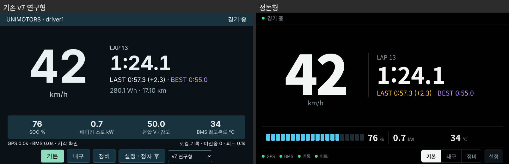
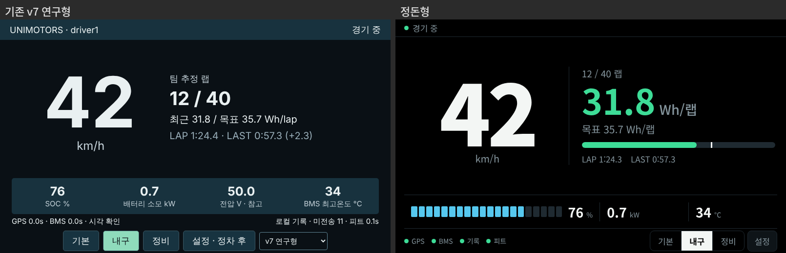
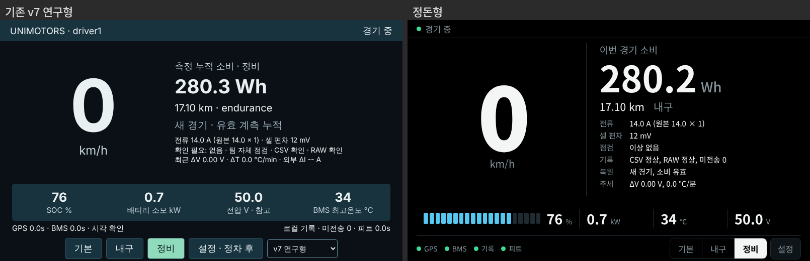
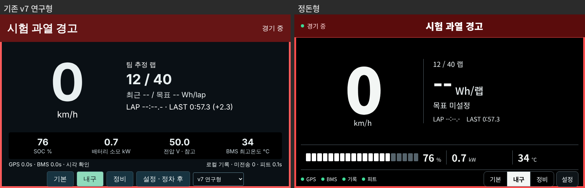

# 정돈형 운전자 화면 (`theme=clean`)

v7 연구형 화면(`driver_dashboard.html`)은 필요한 정보는 다 있지만, 모든 값이 비슷한 굵기의 문장으로 나열되고
센서 나이·미전송 개수 같은 기술 상태가 주행 중에도 계속 보여 한눈에 읽기 어렵다는 의견이 있었다.
정돈형(`vehicle/clean_dashboard.html`)은 **같은 데이터·같은 API·같은 요소 ID**를 쓰면서 배치만 다시 정리한 세 번째 테마다.
기존 v7 연구형과 Claude 클래식은 그대로 두었으므로, 같은 로그를 두 화면에 재생해 시인성을 비교할 수 있다.

## 원칙

| 원칙 | 적용 |
|---|---|
| 한 화면에 핵심은 둘 | 왼쪽 속도, 오른쪽은 모드별 핵심 하나 (기본 = 랩 시계, 내구 = 랩당 소비, 정비 = 이번 경기 소비) |
| 문장 대신 색 | 상단은 평소 단계만 표시하고 경고가 있을 때만 띠 전체가 경고가 된다. 센서·기록·피트 상태는 하단 점 4개(초록/주황/빨강) |
| 기술 상태는 정비 모드로 | 전류 원본·셀 편차·점검·기록·복원·추세는 정비 모드의 표에서만 보인다 |
| 배터리는 막대로 | SOC 20칸 막대 (25% 미만 주황, 12% 미만 빨강). 전압은 정비 모드에서만 |
| 예산은 막대로 | 내구 모드: 최근 3랩 평균 Wh/랩을 목표 대비 초록/주황으로, 막대의 흰 눈금이 목표 |
| 설정은 창 안으로 | 테마 선택을 설정 창으로 옮기고, 설정을 운전자 화면 / 경기 진행 / 배터리와 예산으로 묶음. JSON 직접 편집은 접어 둠 |
| 랩 색 관례 | BEST 보라, 직전 랩이 BEST 면 LAST 도 보라 + ★, 느리면 주황 |

## 비교 (같은 합성 입력, 800×480)

## 사용

- 주소로 고르기: `http://<Pi>:8080/?theme=clean`
- 화면에서 고르기: 다른 테마의 테마 선택 → 정돈형. 정돈형에서는 **설정 → 운전자 화면 → 테마**.
  선택은 브라우저(localStorage)에 저장되어 키오스크 재시작 후에도 유지된다.
- 키오스크를 정돈형으로 고정하려면 autostart 의 URL 을 `http://localhost:8080/?theme=clean` 으로 바꾼다.
- 설치: `install-pi.sh` / `install-vehicle.sh` 가 `clean_dashboard.html` 을 함께 배치한다.
  파일이 없는 이전 설치에서 `?theme=clean` 을 열면 v7 연구형이 나온다.

## 검증

- `scripts/browser-smoke.py` 전체 시나리오를 `UNIMOTORS_SMOKE_THEME=clean` 으로 한 번 더 실행 (CI 포함):
  랩 시계·LAST/BEST, 운전 화면에 기술 문구 없음, 3개 모드 넘침 없음, 운전자 설정·고대비, 전류 부호 저장,
  교체 타이머, BMS 위험 경고, TEAM 메시지 확인, 연결 끊김 감시.
- `scripts/pcars-browser-smoke.py` 에 정돈형 추가: 게임 입력(연료 막대·rpm·냉각수·기어), 일시정지·수신 끊김,
  800×480 / 892×412 / 1366×1024.
- 실제 5인치 DSI LCD·햇빛 아래 가독성, 운전자 반응 시간 비교는 아직 하지 않았다 (11월 시인성 조사 대상).
